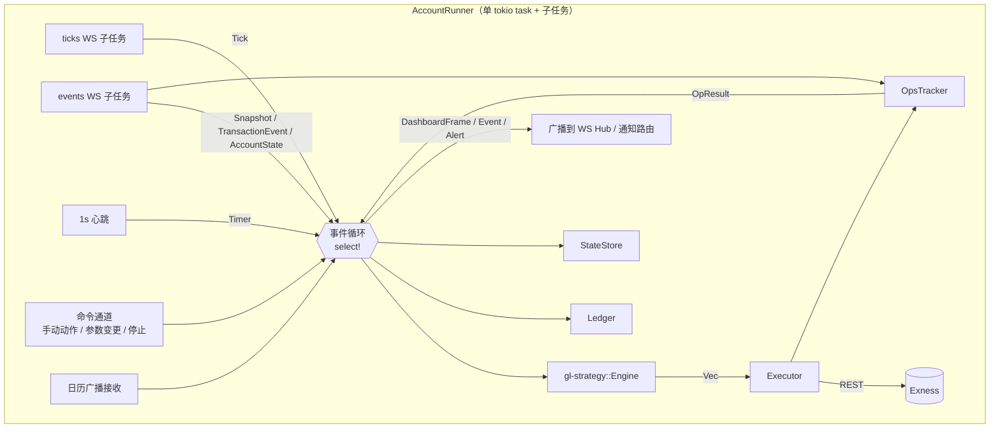

# 03 · 系统架构设计

---

## 1. 总体视图

> 本节为目标架构图；当前对外 WSS 仅承载行情与运行状态，成交事件推送、账户级订阅和 WSS 身份授权尚未接通。当前状态以 [06 · 后端对外 API 规范](06-backend-api.md) §9 为准。

```mermaid
flowchart LR
    subgraph Clients[客户端]
        WEB[Web 控制台<br/>React + Ant Design]
        AND[Android App<br/>(阶段二)]
    end
    subgraph Daemon[gl-server 守护进程（单进程 / 可分片）]
        API[HTTP REST + WS Hub<br/>axum]
        AUTH[鉴权 / RBAC]
        REG[账户注册表 & Supervisor]
        CAL[财经日历服务（全局共享）]
        NTF[通知路由<br/>站内 WS]
        DB[(SQLite via sqlx)]
        subgraph Runners[账户运行器 × N（tokio task）]
            R1[AccountRunner #1]
            R2[AccountRunner #2]
            RN[AccountRunner #N]
        end
    end
    subgraph Exness[Exness Trader API]
        REST[REST（签名）]
        WST[WS ticks]
        WSE[WS events]
    end
    WEB <-->|HTTPS/WSS| API
    AND <-->|HTTPS/WSS| API
    API --> AUTH --> REG
    REG --> R1 & R2 & RN
    R1 & R2 & RN <--> REST & WST & WSE
    R1 & R2 & RN --> DB
    R1 & R2 & RN --> NTF
    CAL --> R1 & R2 & RN
    API --> DB
```

设计原则：
1. **策略内核零 IO**：`gl-strategy` 只接收事件（Tick / 时间 / 持仓快照 / 操作回执）并产出动作（开仓 / 平仓 / 锁仓 / 告警 / 日志），可被实盘运行器与回放工具复用。
2. **账户即任务**：一个账户 = 一个 `AccountRunner`，拥有自己的 API 客户端、WS 连接、台账、策略实例；对外只通过消息通道交互。
3. **Exness 是事实来源，本地是意图与归属**：持仓状态以 Exness 快照 / 事件为准，本地只保存「哪些持仓属于本策略、扮演什么角色」以及策略自身状态。
4. **一切可恢复**：任何会影响后续决策的状态先落盘再确认；重启后对账恢复。

---

## 2. Rust Workspace 划分

```
crates/
├── exness-api        # 无业务语义的 Trader API SDK
│   ├── auth.rs       # Ed25519 签名、EXN-* 头构造、幂等键生成
│   ├── rest.rs       # 全部 REST 端点（强类型请求/响应，Decimal 字符串）
│   ├── ws.rs         # ticks / events 两个流的连接、订阅、心跳、重连
│   ├── models.rs     # OpenAPI 1.0.2 对应模型（serde）
│   ├── limits.rs     # 本地配额核算（令牌桶）
│   └── error.rs      # 公共错误码枚举（1..6001）与分类（可重试 / 不可重试）
├── gl-strategy       # 纯领域内核（no_std 不要求，但禁止 tokio/reqwest/sqlx 依赖）
│   ├── config.rs     # StrategyParams + 校验；RuntimeConstants（pip、ppd、lots 规格）
│   ├── grid_math.rs  # §2 数学
│   ├── basket.rs     # 篮子统计 + TP 引擎 + 加仓判定（方向参数化）
│   ├── lock.rs       # 锁仓三态机
│   ├── risk.rs       # 门禁 + 交易时段模型
│   ├── calendar.rs   # 新闻窗口判定（输入事件列表，不负责抓取）
│   ├── notify.rs     # 千元阶梯状态机 + 文案
│   ├── engine.rs     # 主循环：on_tick / on_timer / on_manual / on_op_result → Vec<Action>
│   └── types.rs      # Tick、OwnedPosition、Snapshot、Action、Event、DashboardFrame
├── gl-runtime        # 把内核接到真实世界
│   ├── runner.rs     # AccountRunner：事件循环、Supervisor 接口
│   ├── market.rs     # Tick 适配、M1 蜡烛聚合与历史回填
│   ├── ledger.rs     # 持仓台账（内存 + sqlx 持久化）
│   ├── ops.rs        # 操作跟踪器（幂等键 ↔ operation_id ↔ 终态）
│   ├── executor.rs   # Action → API 调用（开仓 / 平仓 / 分笔 / 滑点档）
│   ├── reconcile.rs  # 快照 ∩ 台账对账
│   └── state_store.rs# 锁仓状态 / 暂停 / 阶梯 持久化
├── gl-server
│   ├── main.rs       # 配置加载、DB 迁移、Supervisor 启动、axum 监听
│   ├── http/         # REST 路由、DTO、错误映射
│   ├── ws/           # 前端 WS Hub（订阅账户 → 推送帧）
│   ├── auth/         # 用户、密码、JWT、RBAC
│   ├── accounts/     # 注册表、凭证加密、预检
│   ├── calendar/     # Finance Calendar 抓取（全局单例，广播给 runner）
│   ├── notify/       # 通道实现
│   └── db/           # 迁移与 repo
└── gl-replay         # CLI：读取 Tick/Candle 文件 → 驱动 gl-strategy → 输出事件序列
```

依赖方向：`gl-server → gl-runtime → gl-strategy`，`gl-runtime → exness-api`，`gl-replay → gl-strategy`。`gl-strategy` 不得反向依赖。

关键第三方：`tokio`、`axum 0.7`、`tower-http`、`reqwest 0.12 (rustls)`、`tokio-tungstenite`、`ed25519-dalek 2`、`sha2`、`base64`、`rust_decimal`、`sqlx (sqlite, runtime-tokio, migrate)`、`serde/serde_json`、`chrono`、`uuid`、`tracing/tracing-subscriber`、`argon2`、`jsonwebtoken`、`aes-gcm`、`config`、`thiserror/anyhow`。

---

## 3. AccountRunner 运行时模型

### 3.1 内部结构


事件循环是**单线程串行**的：同一账户的 Tick、事件、命令按到达顺序处理，天然避免并发修改篮子状态。不同账户的 Runner 互不共享可变状态。

### 3.2 生命周期
| 阶段 | 动作 |
| --- | --- |
| Init | 解密凭证 → 构建 API 客户端 → 读账户详情 / 品种条件 / limits → 校验（02 §1.4）→ 计算运行时常量与层数上限 |
| Warmup | 拉 M1 历史 ≥ 200 根 → REST 快照 → 加载台账与状态 → 对账（04 §7）→ 连接 ticks / events WS → 收到首个 `trading_state_snapshot` 后置 `Ready` |
| Running | 主循环；期间 WS 断线进入 `Degraded`：不开新仓不加仓，仍允许止盈 / 锁仓推进（基于最后已知报价且报价年龄 < 5s，否则全部暂停） |
| Stopping | 停止接收 Tick，等待在途操作终态（最多 30s）→ 关闭 WS → 落盘 |
| Failed | 不可恢复错误（鉴权失败、账户禁用、品种不可交易）：停止并告警，不自动重启 |

### 3.3 Tick 不丢失保证（硬性规则）

策略要求 Tick **逐笔、保序、不合并**处理（移动锁利峰值棘轮与达标瞬间判定依赖每一笔）。为此：

| 规则 | 内容 |
| --- | --- |
| R1 读取任务极简 | ticks WS 子任务只做「收帧 → 反序列化 → `send`」，禁止 await 任何其它 IO；保证 Exness 不会因慢消费者断连 |
| R2 忙时丢弃 | 每账户的转发任务持续读取共享广播；Runner 处理 `on_tick` 期间，转发任务即时丢弃新 Tick，不在账户队列中积压；空闲时通过非阻塞单槽投递，避免用过时报价驱动交易 |
| R3 事件循环不阻塞 | 循环内只做内存计算与状态写入；REST 调用由执行器 `spawn` 独立任务执行，结果以 `OpResult` 事件回流 |
| R4 可观测与告警 | 指标：队列深度峰值、处理时延（本地接收时间 − Tick 时间戳）、`tick_backpressure` 计数；时延 > 500ms 或出现反压即告警 |
| R5 心跳不替代 Tick | 1s 心跳只承担锁仓计时、告警、看板推送，不参与价格判定 |

已知上游限制：Exness 规范声明 ticks 流可能被节流至每 500ms 一次更新，服务端可能合并一秒内的多笔报价。这是 API 层上限，策略回放对比 MT5 逐笔行情时需以此解释差异。实测（2026-11-19）：12 笔 Tick 间隔 223–809ms，平均约 2 笔/秒；`age`（本地接收 − Tick 时间戳）在 −140ms ~ +170ms，负值来自服务器时钟略快，不视为异常。

### 3.4 Supervisor
- 每个 Runner 由 Supervisor 以 `tokio::spawn` 启动，`JoinHandle` 监控 panic 与异常退出。
- 重启退避：1s, 2s, 4s … 上限 60s；连续 10 次失败转 `Failed` 并告警。
- Runner 内部 panic 不得跨账户传播；`catch_unwind` 仅用于日志，恢复靠重启 + 对账。
- 停机：收到 SIGTERM → 所有 Runner `Stopping` → 最多等待 35s → 退出。

---

## 4. 扩展路径：单进程 → 分片多进程

| 规模 | 形态 | 说明 |
| --- | --- | --- |
| ≤ 300 账户 | 单进程，所有 Runner 在一个 tokio 运行时 | 默认；SQLite |
| 300 ~ 数千 | 主控 + Worker 进程 | 主控：API、鉴权、注册表、日历、通知；Worker：按 `shard_id` 托管一组 Runner；二者通过本机 gRPC / Unix socket 通信；DB 切 PostgreSQL |
| 多机 | Worker 分布到多台机器 | 主控做账户 → Worker 调度与健康检查 |

为此第一阶段就约束：
1. Runner 与外界只经由 `RunnerCommand` / `RunnerOutput` 两条消息通道通信，无共享内存。
2. 注册表记录 `shard_id`（单进程恒为 0）。
3. 数据访问层通过 trait 抽象（sqlx 对 SQLite / PostgreSQL 的 SQL 差异集中在 repo 层）。
4. 日历、通知做成服务接口，Worker 模式下改为 RPC 调用。

---

## 5. 数据模型（SQLite）

```sql
users(id, username UNIQUE, password_hash, role, email NULL, totp_secret NULL, created_at)
accounts(id, exness_account_id UNIQUE, label, instrument, currency, enabled, shard_id,
         api_key, private_key_enc BLOB, key_nonce BLOB, created_at, updated_at)
account_users(account_id, user_id, permission)            -- view | operate
strategy_params(account_id PK, initial_lot, grid_step, grid_step_add,
         grid_step_sec, lot_mult, tp_distance_usd, lock_trigger_usd, updated_by, updated_at)
runner_state(account_id PK, lock_state, locked_since NULL, paused, alert_tier, alert_time NULL,
         last_snapshot_at, updated_at)
ledger(account_id, position_id, role, side, layer, volume, open_price, open_time,
         client_request_id, status, closed_at NULL, PRIMARY KEY(account_id, position_id))
operations(account_id, client_request_id PK, operation_id NULL, kind, side, volume,
         request_json, status, error_code NULL, error_message NULL, created_at, updated_at)
events(id, account_id, ts, level, kind, message, data_json)     -- 策略决策/门禁/告警留痕
audit_log(id, ts, user_id, account_id NULL, action, params_json, result)
```
- `role ∈ {grid, lock, foreign}`；`layer` 对 grid 有效（首单 0）。
- `events` 按账户滚动保留（默认 30 天），提供分页查询。
- 所有金额 / 手数字段用 TEXT 存十进制字符串，Rust 侧 `rust_decimal::Decimal`。

---

## 6. 配置

```toml
# config/config.toml（真实凭证只在 DB 中加密保存，此文件不含账户私钥）
[server]
listen = "127.0.0.1:8080"
public_url = "https://gl.example.com"
jwt_secret = ""
master_key = ""                            # 32 字节 base64，用于加密账户私钥

[database]
url = "sqlite://data/gl.db?mode=rwc"

[exness]
gateway_url = ""                            # 必填：Key Management 页 DNS 组件显示的 Gateway 主机，用于接入点发现
rest_base_url = ""                          # 仅测试用；非空时跳过发现，生产禁止
timestamp_skew_warn_ms = 1500

[calendar]
provider = "financecalendar"
api_key = ""                               # FinanceCalendar API key；留空则禁用日历刷新
retry_sec = 300

[runtime]
shard_id = 0
m1_warmup_bars = 200
stale_quote_sec = 5
```

---

## 7. 关键横切面

### 7.1 时间
- 全系统 UTC；`chrono::DateTime<Utc>`。
- 签名时间戳用系统时钟毫秒；启动时与 Exness 响应头 `Date`（若有）比对，偏差 > 1.5s 告警，> 10s 拒绝启动 Runner（避免 `AUTH` 失败风暴）。

### 7.2 数值
- 金额 / 手数 / 价格一律 `Decimal`；与 API 交互用字符串；Tick 价格 API 为 `number`，转 `Decimal` 后使用。
- 浮点比较容差沿用 02 §1.2。

### 7.3 日志
- `tracing` 结构化字段：`account_id`、`side`、`layer`、`op_id`。
- 等级映射：EA `[INIT …]`→info，门禁拒绝→debug（节流后 info），`[CRITICAL …]`→error。
- 策略级日志同时写入 `events` 表供 UI 展示。

### 7.4 错误处理
- `exness-api` 错误分三类：`Auth`（不可重试、停 Runner）、`Transient`（429 / 503 / 网络，可退避重试）、`Business`（异步 rejected，交给策略决定）。
- 执行器只做「请求送达」层面的重试；策略层面的重试（平仓 200ms、锁仓 5s）由内核按 EA 规则控制。

### 7.5 安全
- 私钥 AES-256-GCM 加密，主密钥从 `config.toml` 的 `[crypto].master_key` 读取；内存中私钥对象实现 `Zeroize`。
- JWT 15 分钟 + 刷新令牌 7 天；手动交易动作只要求令牌 `operate` 权限，不做二次密码验证（已决策），每次动作写审计。
- HTTP 默认本机监听；公网经 Caddy / Nginx TLS 终结。

---

## 8. 部署形态

| 形态 | 说明 |
| --- | --- |
| 单二进制 + SQLite | `gl-server` 静态托管 `web/dist`；systemd 守护；适合 VPS |
| Docker | 两个镜像：`gl-server`、反向代理；数据卷挂载 `data/` |
| 开发 | `cargo run -p gl-server` + `npm run dev`（Vite 代理 `/api`） |

详细运维见 10。
