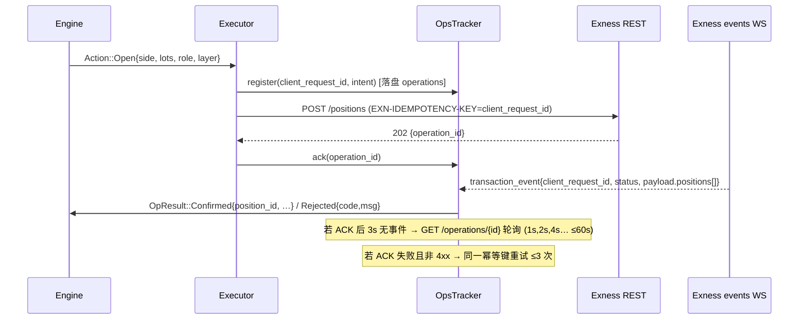

# 04 · Exness Trader API 对接说明

> 依据：`Exness Trader API OpenAPI 1.0.2`（官方 `trading.public.yaml`，副本见 `docs/openapi/`）。本文只写本项目用到的部分与接入决策。
> 实现：`crates/exness-api`（`auth.rs` 签名、`rest.rs` 客户端、`ws.rs` 流、`models.rs` 模型、`error.rs` 错误分类）。

---

## 1. 鉴权与签名

无 Token / 登录流程。每个请求独立签名，六个头：

| 头 | 值 |
| --- | --- |
| `EXN-API-KEY` | 公钥 ID（`exnsk-…`） |
| `EXN-TIMESTAMP` | Unix 毫秒；需在服务端允许窗口内 |
| `EXN-SIGN-VERSION` | 固定 `1` |
| `EXN-IDEMPOTENCY-KEY` | 变更类请求必填 5..128 字符 `[A-Za-z0-9._~-]`；GET **必须带头且值为空** |
| `EXN-DATA` | base64url（无 `=`）编码的 JSON 载荷 |
| `EXN-SIGN` | 对**解码后的载荷字节**做 Ed25519 签名，base64url 无填充 |

载荷字段（顺序无要求但须与头一致）：
```json
{"api_key":"…","idempotency_key":"…或空串","timestamp":1773656070123,"sign_version":1,
 "method":"POST","path":"/v1/trading/accounts/123/positions?volume=0.01","body_hash":"<sha256(body) base64url>"}
```
- `path` = 路径 + 原样查询串，签名后不得重排 / 重编码；重复参数会被拒绝。
- 空 body 的 `body_hash` 恒为 `47DEQpj8HBSa-_TImW-5JCeuQeRkm5NMpJWZG3hSuFU`。
- WS 握手按 `GET` 签名，`path` 为 WS 路径。

SDK 实现要点（`exness-api::auth`）：
- 私钥输入支持：128 hex（seed‖pub，Exness 生成格式，校验后半段与派生公钥一致）、64 hex（纯 seed）、PEM（自备 OpenSSL 密钥）。
- `SigningKey` 包裹 `Zeroizing`。
- 载荷 JSON 用 `serde_json` 紧凑序列化，字段顺序固定为 `api_key, idempotency_key, timestamp, sign_version, method, path, body_hash`；签名的是编码前的字节，服务端只校验「签名 ↔ 发送的字节」一致，不要求规范化形式。
- 时间戳偏差监测见 03 §7.1；官方未公布容忍窗口，按 ≤ 1.5s 告警。

---

## 2. API Key、Gateway 与接入点发现（已按开发者门户确认）

### 2.1 API Key（在 Exness Personal Area → Key Management 创建，不能通过 API 创建）
| 项 | 规则 |
| --- | --- |
| Scope | **Trading Full access**（下单 / 管理持仓）：**一把 Key 只能绑定恰好一个交易账户**；Trading Read-only 可绑 1~10 个账户 |
| 推论 | 多账户托管 = 每个账户各自一把 Full access Key + 私钥，与本项目「每账户独立凭证」一致；注册账户时校验 Key 能访问该账户 |
| Key ID 格式 | `exnsk-{public_api_key}`，即 `EXN-API-KEY` 的值 |
| 私钥（Exness 生成） | 128 个十六进制字符 = 64 字节：**32 字节 seed ‖ 32 字节公钥**；SDK 取前 32 字节重建 `SigningKey` 并校验后 32 字节与派生公钥一致 |
| 私钥（自备） | `openssl genpkey -algorithm ED25519`；在 Key Management 粘贴 SPKI/DER 的单行 Base64 公钥；SDK 需额外支持 PEM 输入 |
| 其它字段 | 可设置密钥名、**过期日期**、**允许 IP**（UI 开放时）；运维需在服务器出口 IP 固定后填写，并在到期前轮换 |

### 2.2 Gateway 与接入点
1. **Gateway 主机**：只能从 Key Management 的 DNS 组件读取，官方明确「不要从示例复制主机名，也不要用账户接入点反推 Gateway」。`https://api.exness.com`、`https://api.exness-api.com` 在文档中标注为仅供评审原型，不是发现的替代品。配置项 `exness.gateway_url` 必填。
2. **发现请求**：`GET {gateway_url}/v1/trading/access-point?account_id={id}`，签名 GET（`EXN-IDEMPOTENCY-KEY` 必须带且为空，`EXN-DATA.path` = `/v1/trading/access-point?account_id={id}`）。
3. **响应**：`{"access_point":"https://ap-xxxxxxxx.exness.com","account_id":"123456"}`（`account_id` 为字符串）。
4. **使用**：该账户所有 REST 用 `access_point` 作 Base；WS 用同主机 `wss://`，路径 `/v1/server-events/accounts/{id}/ws/{ticks|events}`，握手按 GET 签名，并必须带 `Sec-WebSocket-Protocol: exness-ws-protocol`（实测服务器强制该子协议，缺失时握手被拒）。实测（2026-11-19）：`api.exness.com` → `https://ap-41f12819.exness.com`，发现耗时约 1.3s；响应 `account_id` 为字符串。
5. **缓存**：发现接口有限流，Runner 生命周期内缓存一次；收到 `401/403` 且非鉴权码、或连接持续失败时重新发现一次；`429` 按 `Retry-After` 退避。
6. `exness.rest_base_url` 非空时跳过发现（仅用于测试环境），生产禁止。

---

## 3. 使用的端点

| 用途 | 方法 / 路径 | 调用时机 | 备注 |
| --- | --- | --- | --- |
| 账户详情 | `GET /v1/configuration/accounts/{id}/account` | 预检、Init | `settings.currency / leverage / trade_mode / account_status / execution_mode` |
| 品种列表 | `GET /v1/configuration/accounts/{id}/instruments` | 预检 | 校验配置品种存在 |
| 品种条件 | `GET /v1/configuration/accounts/{id}/instruments/{instrument}/conditions` + Server Events `instruments` | Init、WS 重连后 REST 对账、`instrument_event` 推送 | 按账户订阅选定黄金品种；完整条件变化后仅更新该账户策略的 watch 状态。`trade_sessions` 为 UTC 周级窗口 |
| 限额 | `GET /v1/configuration/accounts/{id}/limits` | Init、每小时 | 填充本地令牌桶；候选蜡烛上限 |
| 快照 | `GET /v1/trading/accounts/{id}/snapshot` | Init、重连后、对账 | `orders / positions / account_state` |
| 蜡烛 | `GET /v1/market-data/accounts/{id}/candles?instrument&timeframe=M1&price_type=bid&from&count` | Warmup、每分钟补齐 | `from` 含、`to` 不含；M1 保留 1 年 |
| 开仓 | `POST /v1/trading/accounts/{id}/positions` | 首单 / 加仓 / 锁仓 | 202 ACK |
| 平仓 | `DELETE /v1/trading/accounts/{id}/positions/{position_id}[?volume&price&deviation]` | 止盈 / 手动 / 自动全平 | 202 ACK；整笔平仓不传 `volume` |
| 操作状态 | `GET /v1/trading/accounts/{id}/operations/{operation_id}` | 事件超时兜底 | 保留 24h |
| 订单历史 | `GET /v1/history/accounts/{id}/orders` | UI 历史页 | 游标分页 ≤200 |
| 成交历史 | `GET /v1/history/accounts/{id}/deals` | UI 历史页、盈亏统计 | `deal_type=close` 含 `profit` |
| 事件流 | `WS /v1/server-events/accounts/{id}/ws/events` | 常驻 | 订阅 `transactions` 和账户黄金品种的 `instruments`；策略相关条件仅在变化时扇出到运行器 |
| 行情流 | `WS /v1/server-events/accounts/{id}/ws/ticks` | 常驻 | 订阅 `ticks` + instruments |

不使用：挂单（limit/stop/sltp）、改单、HMR 订阅（阶段二可用于展示杠杆变更）。

---

## 4. 开仓请求映射

```json
POST /positions
{"instrument":"XAUUSD","side":"buy","volume":"0.01",
 "price":"4123.456","deviation":"200",          // 仅 exec_mode=instant 时附带
 "comment":"GoldLegend_Buy_0"}
```
| EA 概念 | 映射 |
| --- | --- |
| `OpenBuy/OpenSell(lots, comment, dev_units)` | `side`、`volume = normalize_lots(lots)` 字符串、`comment` |
| 滑点档（20 / 50 / 300 点） | `exec_mode=instant`：`price` = 当前 ask/bid，`deviation` = units × 10（3 位报价）；`exec_mode=market`：不传，两档重试退化为「同一请求重试」 |
| SL/TP | 不使用（EA 传 0） |
| magic | 无；由台账承载 |

平仓：`DELETE /positions/{position_id}`，整笔；`instant` 模式下附 `price` 与 `deviation`（紧急档 300 点）。

---

## 5. 异步操作模型（OpsTracker）



幂等键格式：`gl.{account}.{role}.{layer}.{unix_ms}.{rand6}`，全部字符在允许集合内，长度 < 128。实测：同一幂等键 + 同一载荷重放返回**同一** `operation_id`（HTTP 202），不新开仓，可安全用于超时重试。

终态处理：
| 结果 | 动作 |
| --- | --- |
| `confirmed` / `success` | 从 `payload.positions` 取 `state=open` 的 `position_id` 写入台账（role/side/layer）；篮子清除 `pending_op` |

实测（2026-11-19）：`transaction_event` 回显 `client_request_id` 与 `operation_id`；`payload.positions[].state` 开仓为 `open`、平仓为 `closed` 且 `volume=0`；开仓 deal 的 `profit.currency` 为空串，平仓 deal 带 `USD` 与盈亏金额。ACK → 事件实测时延 0.4–0.6s，3s 轮询兜底阈值合理。
| `rejected` | 记录 `error_code/error_message`；清除 `pending_op`；策略按 EA 规则决定是否重试（加仓：下一 Tick 自然重评；锁仓：5s 后重试；平仓：200ms 重试） |
| `failed` | 同 rejected，但计入系统告警 |
| 超时未知 | 触发对账（§7）；若快照出现方向、手数、时间匹配且台账无记录的持仓 → 认领为该操作结果；否则标记失败 |

同一篮子任一时刻最多一个在途开仓操作；平仓可并发（每笔持仓一个操作），篮子 `closing_in_progress` 直到全部终态且快照为空。

---

## 6. 持仓归属台账（替代 magic / comment）

`Position` 模型不含 `comment` 与 `magic`，因此：
- 本策略开出的每笔持仓在 `confirmed` 时写台账：`(account, position_id, role ∈ {grid, lock}, side, layer, volume, open_price, open_time, client_request_id)`。
- 策略统计、风控、平仓**只**遍历台账中 `status=open` 的持仓。
- 快照中存在但台账没有的持仓 = `foreign`：UI 标记、告警，默认不参与策略（相当于 MT5 上其它 magic 的单）。管理员可「收编」为 grid（指定方向与层号）或 lock。
- 两阶段全平：先 `role=grid` 再 `role=lock`（等价 EA 的 HEDGE 注释识别）。
- 请求仍附 `comment`（`GoldLegend_Buy_N` / `GL_NET_HEDGE`）供人工在 Exness 终端辨识，但不作为程序依据。

---

## 7. 对账与恢复

触发：Runner 启动、events WS 重连收到新 `trading_state_snapshot`、操作超时、每 10 分钟定时。

```
S = 快照 positions（state=open）
L = 台账 open 持仓
for p in L \ S: 台账标记 closed（closed_at=now，来源 reconcile）；若篮子仍 closing → 继续
for p in S \ L: 若存在匹配的超时操作（方向/手数/时间窗 ±60s）→ 认领；否则登记 foreign 并告警
for p in S ∩ L: 同步 volume（部分平仓）、swap、commission
账户状态 ← snapshot.account_state
```
WS 事件语义：
- 订阅确认：回 `{"id":"…","code":200}`；实测 ticks 流的 `code` 为数字 `200`，events 流为字符串 `"200"`，SDK 以原样 `WsInbound::Ack` 兼容。
- `trading_state_snapshot`：订阅 `transactions` 后首帧，作为基线触发对账。
- `transaction_event`：`status=success` 时按 `payload.positions[].state` 更新台账（`closed` → 标记关闭）；`operation_id/client_request_id` 交给 OpsTracker；无 `operation_id` 的事件（系统平仓、余额操作）直接应用。
- `account_state_event`（2s 周期）：更新 `balance/equity/used_margin`；千元阶梯与锁仓判定用本地计算的 `floating_pnl`，`balance` 取此处。
- 断线：无重放，必须重连 + 重订阅 + 以新快照为基线。

---

## 8. 限流与配额

- `GET /limits` 返回全局与每操作的 `limit/window_seconds`；SDK 为每个 `api_operation_id` 建令牌桶，请求前 `acquire`，桶空时按策略：行情 / 快照类等待，交易类立即执行但记录超额告警（交易安全优先于配额）。
- 实测（模拟账户，2026-11-19）：全局 REST 15 次/秒；`getCandleHistory` 2/s（单次 ≤1000 根）、`openPosition` 4/s、`closePosition` 4/s、`getTradingStateSnapshot` 2/s、`getOperationStatus` 10/s、`getAccountDetails` / `getInstrumentCondition` 4/s、`getAvailableInstrumentList` / `getLimits` 2/s。WS：`max_active_connections=5`、`connection_rate=10/1s`（burst 20）、`inbound_message_rate=50/1s`、`strikes.threshold=10 / 600s`。
- `429 REQUEST_RATE_LIMIT` 不自动重试；记录并提升本地桶的保守系数。
- WS：每账户 `max_active_connections` 通常很小，本项目每账户固定 2 条连接；重连遵守 `connection_rate`，退避 1s→30s。
- 订阅不存在的品种会计 strike，预检阶段先用 `instruments` 列表校验。

---

## 9. 错误码处理策略

| 范围 | 代表码 | 分类 | Runner 行为 |
| --- | --- | --- | --- |
| 1000-1002 | AUTH_* | 致命 | 停止 Runner → `Failed`，告警 |
| 2000-2002 | ACCOUNT_* | 致命 / 降级 | `NOT_FOUND/DISABLED` 停止；`CLOSE_ONLY` 进入只平不开 |
| 3000-3015 | REQUEST_* | 程序缺陷 / 限流 | 记录 error；`3015` 见 §8 |
| 4000-4004 | MARKET_* | 业务 | `SESSION_CLOSED/NO_QUOTES` 视为暂时不可交易，按 EA 重试节奏 |
| 5000-5010 | TRADING_RULE_* | 业务 | `INSUFFICIENT_MARGIN/MARGIN_LEVEL_TOO_LOW` 记 critical 并告警；手数类说明归一化缺陷 |
| 6000-6001 | EXECUTION_* | 业务 | requote → 升滑点档重试（instant）；rejected → 按 EA 重试 |
| 1-3 | SYSTEM_* | 暂时 | 指数退避 |

错误响应体形态（规范）：`{"code": 1001, "error_message": "AUTH_INVALID_SIGNATURE"}`；`code` 是自动化的主信号，`error_message` 为 `<CATEGORY>_<REASON>` 稳定文本。`REQUEST_RATE_LIMIT (3015)` 是同步 429，官方声明**不自动重试**，应依赖 `limits` 做本地配额核算；`SYSTEM_RATE_LIMIT (1)` 是交易平台节流，只出现在异步终态。SDK 的 `Error::class()` 把 1000–2002 归为 Fatal、3015 / 1–3 / 5xx 归为 Transient、4xxx–6xxx 归为 Business、其余 3xxx 归为 Client。

---

## 10. 数值与时间约定

- 金额 / 手数 / 实体价格：字符串 → `Decimal`，输出时 `volume` 按 `volume_step` 小数位、价格按 `point_digits` 格式化。
- Tick / 蜡烛价格：JSON number → `Decimal::from_f64_retain` 后按 `point_digits` 取整。
- 时间：ISO8601 带偏移 → `DateTime<Utc>`；K 线 `from` 含 `to` 不含。

---

## 11. 已知差异与风险

| 项 | 说明 | 缓解 |
| --- | --- | --- |
| Tick 节流 ≤ 500ms | 峰值棘轮可能略低于 MT5 | 接受；回放对比时标注 |
| 无同步成交回执 | 篮子动作有数百毫秒在途期 | `pending_op` 守卫 + 对账 |
| 无 comment 回读 | 无法凭注释识别锁仓腿 | 台账 |
| 接入点机制 | Gateway 主机来自 Key Management，不可硬编码 | 配置项必填 + 发现结果缓存 + 失败重发现 |
| ~~`exec_mode` 未知~~ 已实测：黄金为 `market` | `deviation` 不生效 | 两种模式都实现；`market` 下以重试替代滑点档 |
| ~~对冲支持~~ 已实测多空并存 | — | 已确认，风险关闭 |
| WS 子协议 | 握手必须带 `exness-ws-protocol` | SDK 默认携带，可用 `ClientConfig::ws_subprotocol` 关闭 |
| 瞬时 TLS 中断 | 实测出现一次 `tls handshake eof` | 归为 Transient，退避重试 |
| 每 Key 一个账户 | 多账户需多把 Key | 账户注册流程逐账户录入 Key |
| Key 过期 / IP 限制 | 到期或换机即全停 | 注册时记录到期日，到期前 7 天告警；出口 IP 固定 |
