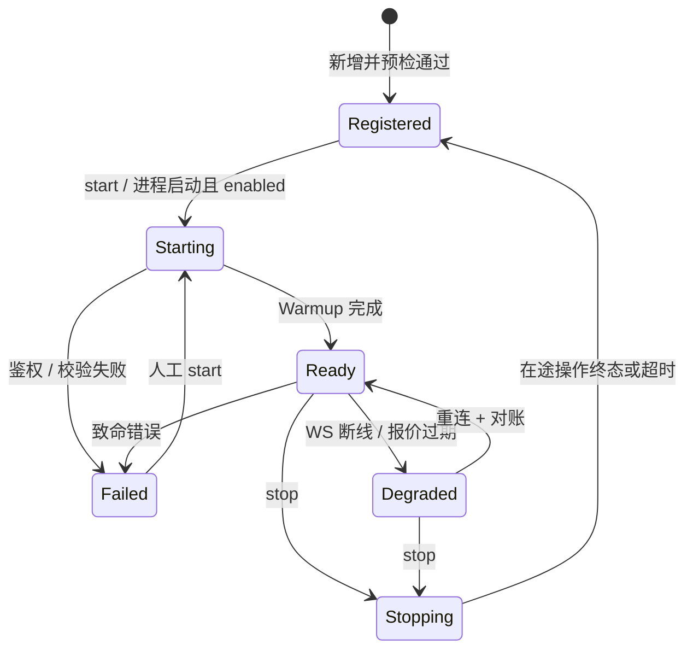

# 05 · 多账户设计

---

## 1. 账户模型

```
Account
├── id (内部主键)
├── exness_account_id      # Exness 交易账号，唯一
├── label                  # 显示名（客户名 / 档位）
├── instrument             # 预检时自动匹配的黄金符号：XAUUSD / XAUUSDm / XAUUSDc（只读）
├── currency               # 预检时从 Exness 读取：USD | USC
├── credentials            # api_key 明文 + private_key 密文（AES-256-GCM）
├── enabled                # 是否随进程自动启动
├── shard_id               # 分片（单进程恒 0）
├── StrategyParams         # 独立一份（02 §1.1）
├── RunnerState            # lock_state / locked_since / paused / alert_tier
├── Ledger[]               # 持仓归属
└── Users[]                # 授权用户与权限
```

一个 Exness 账号只允许注册一次；同一账号绝不允许两个 Runner（避免双开仓）。Worker 分片模式下由注册表保证唯一归属。

---

## 2. 凭证管理

- Exness 规则：**Trading Full access 密钥恰好绑定一个交易账户**，因此每个托管账户必须在客户的 Personal Area → Key Management 单独创建一把 Key（可设到期日与允许 IP）。注册流程按账户逐一录入，不存在「一把 Key 管多个账户」。
- 新增账户时，前端提交 `api_key`、`private_key`（128 hex / 64 hex / PEM）与 Key 到期日，后端立即：解析私钥（128 hex 时校验公钥段）→ 用 Gateway 发现接入点 → 读账户详情验证 → 成功后加密落库，**明文不写日志、不回显、不进入事件表**。
- 到期日：到期前 7 天每日告警；到期后 Runner 转 `Failed`，等待替换凭证。
- 加密：`AES-256-GCM`，每条记录随机 12 字节 nonce；主密钥来自 `config.toml` 的 `[crypto].master_key`（32 字节 base64）。
- 主密钥轮换：提供 `gl-server rotate-key --old --new` 命令离线重加密。
- 修改凭证 = 停止 Runner → 预检 → 替换 → 重启。
- 删除账户：要求 Runner 已停止且台账无 open 持仓（可 `--force` 仅由管理员）。

---

## 3. 隔离边界

| 资源 | 隔离方式 |
| --- | --- |
| API 客户端 / 签名密钥 | 每 Runner 独立实例 |
| WS 连接 | 每账户 2 条，互不复用（接入点可能不同；限流按账户计） |
| 策略实例与篮子状态 | Runner 私有，内存不共享 |
| 持久化 | 所有表以 `account_id` 为分区键；事件、日志、告警按账户查询 |
| 日志 | `tracing` span 带 `account_id`；可按账户导出 |
| 配额 | 令牌桶按账户 |
| 告警节流 | 千元阶梯、锁仓推送节流状态按账户 |

共享资源（只读、广播）：财经日历事件列表；系统时钟校准结果；品种条件缓存（按 `instrument` 键，但每账户仍以自己账户请求结果为准，因为条件是账户维度的）。

---

## 4. 生命周期与状态



- `stop` 只停止策略，不平仓；UI 必须明确提示「停止后持仓不再受管，风控不再运行」。
- 账户在 `Stopping/Registered` 期间仍可查看快照（按需拉取），但不能执行手动动作（需先 start，或使用「离线紧急平仓」：以一次性客户端直接 DELETE 全部台账持仓，管理员权限）。

---

## 5. 并发与资源预算

| 项 | 每账户 | 200 账户 |
| --- | --- | --- |
| tokio 任务 | 1 主循环 + 2 WS 读 + 1 心跳 + 临时执行任务 | ~800 常驻任务 |
| 套接字 | 2 WS + REST 连接池（复用） | ~400 长连接；`ulimit -n ≥ 4096` |
| 内存 | 策略/台账 < 1 MB；连接缓冲 ~300 KB | < 500 MB 含运行时 |
| 消息 | ticks ≤ 2/s，account_state 0.5/s | ≤ 500 msg/s，CPU 可忽略 |
| SQLite 写 | 事件/操作落盘 | WAL 模式；单写者队列串行化，批量提交 |

SQLite 单写者限制在数百账户内无压力；写入经统一的 `DbWriter` 任务批量提交（每 50ms 或 100 条），读取走连接池。超过时切 PostgreSQL（03 §4）。

---

## 6. 用户与权限

| 权限 | 能力 |
| --- | --- |
| `view` | 查看账户状态、持仓、事件、历史 |
| `operate` | + 手动动作（锁仓 / 平仓 / 暂停）、修改策略参数 |
| admin（全局） | + 账户 CRUD、启停、凭证、用户管理、收编外部持仓、系统设置 |

- 用户 ↔ 账户多对多；admin 不需要显式授权。
- 修改策略参数可被管理员按账户锁定（`params_locked`），用于托管客户账户时由我方统一管理参数。
- 所有手动动作与参数修改写 `audit_log`。

---

## 7. 多账户 UI 语义

- 总览页按账户卡片 / 表格展示；支持按状态（锁仓 / 暂停 / 避险 / 断线）过滤与排序。
- 批量操作仅限 admin 且限于「暂停 / 恢复」；批量平仓 / 锁仓不提供（风险太高，必须逐账户确认）。
- 告警面板按账户归类，每条告警带账户标签。

---

## 8. 从单进程到分片的迁移步骤（预留）

1. 注册表增加 Worker 心跳表 `workers(id, shard_id, last_seen, capacity)`。
2. `gl-server` 增加 `--role control|worker --shard N` 参数；`control` 不启动 Runner，只提供 API 并把 `RunnerCommand` 经 Unix socket / gRPC 转发到持有该 `shard_id` 的 Worker。
3. Worker 把 `RunnerOutput`（帧、事件、告警）回传 control，由其 WS Hub 分发。
4. DB 切 PostgreSQL，`DbWriter` 改为直接写入。
5. 账户 `shard_id` 由 control 在新增时按容量分配，支持手动迁移（stop → 改 shard → start）。

单进程阶段不实现以上步骤，但接口按此边界划分。
