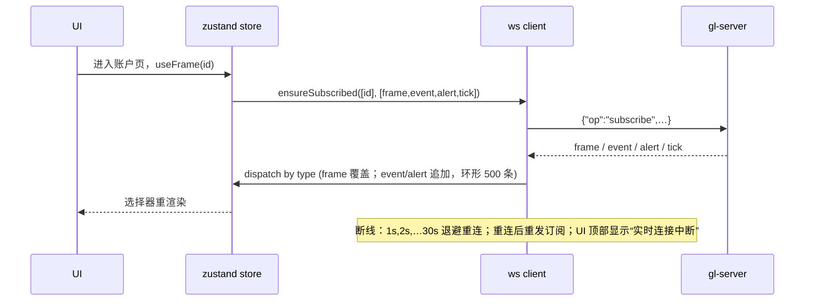

# 07 · Web 前端设计（React + Ant Design）

---

## 1. 技术选型

| 项 | 选择 | 理由 |
| --- | --- | --- |
| 框架 | React 18 + TypeScript | 生态成熟，与 Ant Design 深度集成 |
| 构建 | Vite | 快；`npm run build` 产物由 gl-server 静态托管 |
| UI | Ant Design 5（`antd`、`@ant-design/icons`、`@ant-design/pro-components` 可选） | 表格 / 表单 / 抽屉 / 通知组件完备 |
> **当前实现说明**：TanStack Query / Zustand 为 M6 设计稿选型，实际代码采用 axios 统一实例（`web/src/lib/api.ts`，含 JWT 拦截与 401 全局登出）+ React hooks 轮询 / WebSocket。引入状态库属于后续优化项，待引入后更新本表。

| 服务端状态 | TanStack Query | 缓存、重试、失效 |
| 客户端状态 | Zustand | 轻量；承载 WS 帧与订阅 |
| 路由 | react-router v6 | |
| 图表 | lightweight-charts（K 线）+ `@ant-design/plots`（统计） | |
| 表单校验 | antd Form + zod | 与后端 422 字段错误对齐 |
| i18n | i18next（zh-CN 默认，预留 en） | |
| 时间 | dayjs（UTC 插件） | 全站 UTC 显示并标注 |

---

## 2. 目录结构

```
web/
├── src/
│   ├── api/            # OpenAPI 生成的客户端 + 封装（axios）
│   ├── ws/             # WS 客户端：连接、重连、订阅管理、帧分发到 store
│   ├── store/          # zustand：auth、accountsFrame、alerts、ui
│   ├── pages/
│   │   ├── Login/
│   │   ├── Overview/            # 多账户总览
│   │   ├── Account/             # 账户详情（Tabs：看板 / 持仓 / 参数 / 事件 / 历史）
│   │   ├── Accounts/            # admin：账户管理（新增 / 凭证 / 启停 / 授权）
│   │   ├── Alerts/
│   │   ├── System/              # 健康、日历、通知通道、用户
│   │   └── Audit/
│   ├── components/
│   │   ├── HudBar/              # 等价 EA 顶部胶囊状态条
│   │   ├── BasketCard/          # 多 / 空篮子面板
│   │   ├── QuickActions/        # 等价 Q 菜单七按钮
│   │   ├── PositionsTable/
│   │   ├── ParamsForm/          # 带推导预览
│   │   ├── PriceChart/
│   │   ├── EventStream/
│   │   └── RunnerStatusTag/
│   ├── hooks/
│   ├── theme/           # antd ConfigProvider token（深色 + 金色）
│   └── i18n/
└── vite.config.ts       # dev 代理 /api → 127.0.0.1:8080
```

---

## 3. 页面与路由

| 路由 | 页面 | 核心内容 |
| --- | --- | --- |
| `/login` | 登录 | 用户名 / 密码 /（TOTP） |
| `/` | 总览 | 账户卡片网格或表格切换；每卡：label、状态标签（运行 / 降级 / 停止 / 失败）、净值、浮盈亏、多 N 层 / 空 N 层、锁仓 / 暂停 / 避险徽标；筛选与排序；admin 可批量暂停 / 恢复 |
| `/accounts/:id` | 账户详情 | 见 §4 |
| `/accounts/:id/params` | 参数编辑 | `ParamsForm` |
| `/admin/accounts` | 账户管理 | 新增向导（凭证 → 预检报告 → 参数 → 完成）、凭证替换、启停、删除、授权用户 |
| `/alerts` | 告警中心 | 列表、确认、按账户筛选 |
| `/system` | 系统 | 健康、日历、通知通道、版本 |
| `/admin/users` | 用户 | CRUD、角色 |
| `/audit` | 审计 | 查询 |

---

## 4. 账户详情页布局

```
┌─────────────────────────────────────────────────────────────────────┐
│ HudBar: 金色传说 | [已锁仓·待人工处理] | 极限抗波幅 $58.3 (9层) | UTC 10:00 │
├──────────────────────────────┬──────────────────────────────────────┤
│ PriceChart (M1 K线)           │ QuickActions                         │
│  - 多均价线 / 空均价线        │  [一键锁仓][一键平仓][一键平亏]        │
│  - 目标出场线 / 防守价线      │  [一键平盈][一键平多][一键平空]        │
│  - Bid/Ask                    │  [暂停开仓 / 恢复开仓]                 │
├──────────────┬───────────────┤  账户: 余额 / 净值 / 浮盈亏 / 净敞口    │
│ BasketCard 多 │ BasketCard 空  │  点差 / 报价年龄 / WS 状态             │
│ 层数 手数 均价│                │                                      │
│ 浮盈 / 目标   │                │                                      │
│ 安全垫 / 放飞 │                │                                      │
│ 防守价 / 在途 │                │                                      │
├──────────────┴───────────────┴──────────────────────────────────────┤
│ Tabs: 持仓表 | 事件流 | 操作记录 | 成交历史 | 参数                      │
└─────────────────────────────────────────────────────────────────────┘
```

HudBar 颜色与 EA 一致：锁仓红（`#ff5050`）、暂停橙（`#ffa537`）、避险黄（`#ffc832`）、正常金（`#d4af37`）；「新闻源不可用」独立追加。

QuickActions 颜色对应 EA 七按钮（琥珀金 / 正红 / 明橙 / 翡翠绿 / 宝石蓝 / 魅紫 / 青灰↔绿），每个按钮点击弹 `Modal.confirm`，文案复用 EA tooltip（不要求再次输入密码）。执行中显示 `action_progress` 进度（已提交 / 已确认 / 失败）。

BasketCard 字段：层数 `3/9`、手数、均价、浮盈（着色）、目标利润与完成度进度条、安全垫点数（≥35 标「可放飞」，<35 标「达标秒平」）、放飞状态（激活时显示最高有利价与防守价）、下一加仓距离（当前距离 / 步长）、在途操作徽标、平仓中徽标。

---

## 5. 实时数据流

### 当前实现

- 页面通过 `new WebSocket()` 连接同源 `/ws`；HTTPS 页面自动使用 WSS，Vite 开发服务器代理到本地 gl-server。
- 当前只处理 `tick`（行情）与 `runner_status`（策略运行状态）。WebSocket Hub 还定义了 `event` / `alert` 帧，但尚未由后端发布或由前端消费。
- 余额、净值、保证金与持仓由 `/accounts/{id}/snapshot` 每 5 秒轮询；快照首次加载只建立持仓 ID 基线，后续持仓 ID 增删触发通用开仓 / 平仓提示音。历史成交每 10 秒从 REST 刷新。
- 手动开仓、锁仓和平仓在操作 API 返回成功后播放对应提示音。自动止盈/止损尚无明确成交原因推送，因此无法可靠区分止盈、止损与其他平仓。
- 音效文件位于 `web/public/sounds/`，浏览器首次交互后解码预载。声音不是成交确认依据，Exness 回执与账户快照才是交易状态来源。

### 目标实时链路



该图描述目标协议，不代表当前已经实现。上线账户级成交/告警帧前，服务端必须先为 `/ws` 增加身份认证和账户授权过滤；成交帧应在后台收到对应 Exness 交易回报后发布，并带稳定事件 ID 供客户端去重。WS 断线期间漏掉的变化由快照重连对账补齐。

经济日历状态由服务端共享刷新；只在「日历就绪状态 / 下一场高影响事件时间」变化时，通过 `watch` 通知各运行账户。品种时段按账户订阅 Exness Server Events `instruments`；启动和每次重连后用 REST 条件快照校准，只有条件变化时更新对应账户策略。策略本身只读取内存状态，不直接访问 API。

- 目标方案中 REST 用于首屏与非实时数据，WS 帧到达后覆盖客户端缓存；当前页面使用 React state/hooks，尚未引入 Query/Zustand。
- 总览页只订阅 `frame`（服务端已 250ms 节流），详情页追加 `tick` 驱动图表。
- 页面隐藏（`visibilitychange`）时取消 `tick` 订阅以省流量。

---

## 6. 参数编辑（ParamsForm）

- 字段与校验规则来自 02 §1.1；校验在前端与后端双做。
- 输入变化 300ms 防抖调用 `/params/preview`，右侧实时显示：层数上限、手数序列（L1…Ln）、开满理论浮亏、剩余缓冲、最后一层振荡空间、极限抗波幅，复刻 EA `[AUTO-GRID NOTICE]` 日志。
- 保存前对比差异列表并确认；被 admin 锁定时只读。

---

## 7. 账户新增向导（admin）

1. 基本信息：Exness 账号、显示名。
2. 凭证：API Key、私钥（密码框，可粘贴 64/128 hex），提示永不回显。
3. 预检：调用 `POST /accounts`，展示每项检查结果（含自动匹配到的黄金符号与币种）；任一失败停留本步。
4. 参数：默认值预填，含推导预览。
5. 完成：可选立即启动。

---

## 8. 主题与可用性

- 深色为默认（交易员夜间使用），`ConfigProvider` token：`colorPrimary=#d4af37`、`colorBgBase=#141a22`、成功 / 危险保持 antd 默认。
- 所有金额按账户币种显示单位（USD / USC），不换算。
- 时间显示 `HH:mm:ss UTC`，悬停显示完整 ISO。
- 键盘快捷键：详情页 `Q` 聚焦 QuickActions（致敬 EA），不直接触发动作。
- 响应式：≥1280 三栏；<1280 两栏；<768 单栏并折叠图表。
- 声音：当前交易提示音由 `/sounds/*.wav` 播放，未提供静音开关；自动持仓变化触发的是通用开仓 / 平仓提示，精确止盈/止损提示待成交事件接通。

---

## 9. 构建与部署

- `npm run build` → `web/dist`；`gl-server` 以 `tower-http::ServeDir` 托管并 SPA 回退 `index.html`。
- 开发：Vite `server.proxy` 把 `/api` 代理到本地 HTTP 后端，并把 `/ws` 代理到本地 WebSocket 服务。
- 环境变量：`VITE_API_BASE`（默认同源）。
